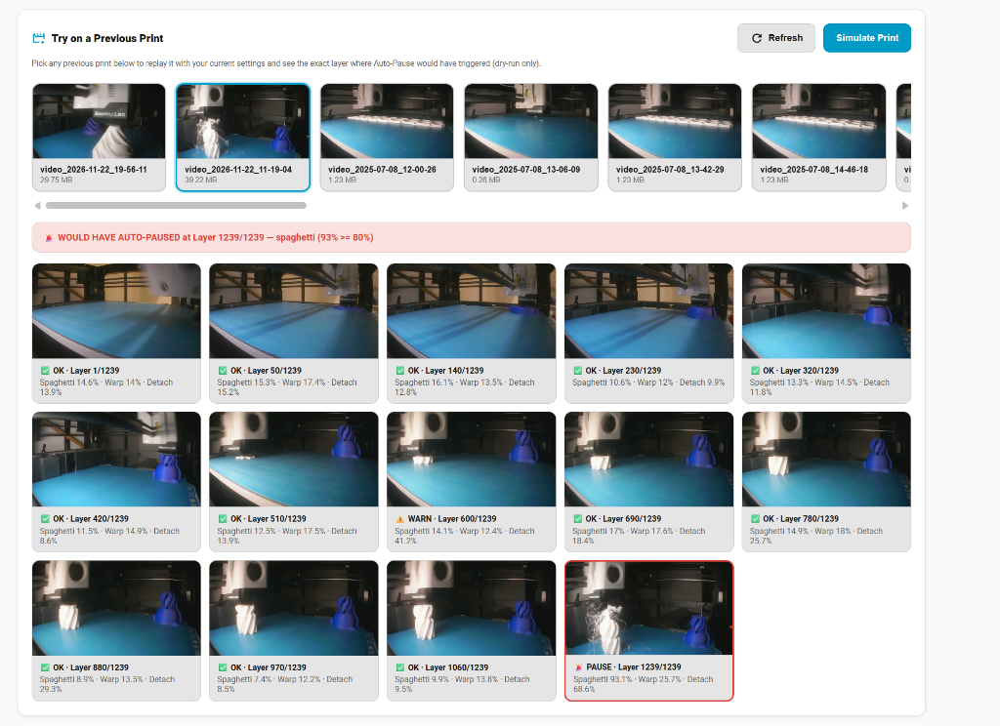
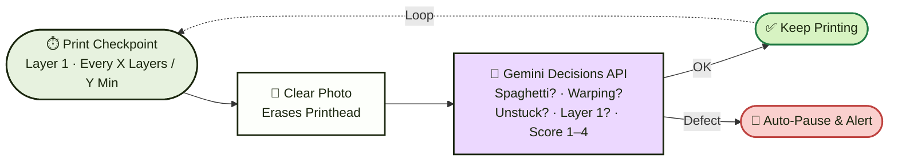

# Bambu AI Guard — Sleep Soundly While Your Bambu Lab Prints

**Turn your Bambu Lab P1P, P1S, A1, or A1 Mini into a self-monitoring smart printer in 30 seconds.**

*Real 1,239-layer Bambu Lab P1P print replayed through Bambu AI Guard: **0 false positives** across Layers 1–1060, then instant **93.1% Spaghetti Auto-Pause** on the exact failure frame.*

---

## Why We Built This

If you own a **Bambu Lab P1P, P1S, A1, or A1 Mini**, you know the feeling: you start a 9-hour print before going to bed or leaving for work, and you spend the first hour refreshing the camera feed—wondering if a corner is going to warp, if a tall part will detach at layer 40, or if you'll come home to **300 grams of wasted filament and a hotend encased in a giant ball of melted plastic**.

Only the flagship X1C ships with built-in AI spaghetti detection, and even then, it struggles to catch subtle corner warping or early first-layer lifting before the part is ruined. Meanwhile, third-party cloud camera guards require monthly subscriptions, continuous video streaming that saturates your printer's weak Wi-Fi chip, or an always-on desktop GPU.

**We built Bambu AI Guard so every Bambu Lab owner can have automatic, reliable AI print protection inside Home Assistant—with zero monthly fees, zero idle CPU usage, and zero extra hardware.**

> **Built for Low-Power Home Assistant Hardware (Raspberry Pi / HA Green):**  
> Running local computer-vision models (like YOLO/ONNX) directly on a Raspberry Pi spikes CPU/RAM and still struggles to spot subtle 2 mm corner warping or bad first-layer adhesion. By offloading quick checkpoint snapshots to Google's **Gemini Decisions API** on the free tier, Bambu AI Guard uses **~0% CPU and < 5 MB RAM** on your Pi—no GPU or Coral TPU required.

---

## What It Solves

| The 3D Printing Nightmare | How Bambu AI Guard Solves It |
| :--- | :--- |
| **1. "Spaghetti Monsters" & Hotend Blobs** | Detects loose filament loops in mid-air and **automatically pauses your printer** before melted plastic backs up into your toolhead. |
| **2. First-Layer Peeling (When 90% of Prints Fail)** | Instead of waiting 15 minutes for Layer 1 to finish, it runs **2 to 3 spaced checks during Layer 1 itself**, catching unglued brims or lifted Gridfinity pads in the first 60 seconds. |
| **3. Corner Warping & Part Detachment** | Spots outer corners curling off the build plate or individual objects shifting before the nozzle knocks the entire print off the bed. |
| **4. The Toolhead Blocking the Camera** | On **CoreXY printers (`P1P`, `P1S`, `X1C`)**, it takes 3 quick snapshots 2.5 seconds apart and mathematically **erases the moving printhead**, giving the AI a crystal-clear, unobstructed view of your print. |
| **5. Motion Blur on Bed-Slingers (`A1`, `A1 Mini`)** | Automatically recognizes the **A1 / A1 Mini's** moving Y-axis bed and switches to crisp single-frame layer-transition capture so your print is never blurred. |
| **6. Subscription Fatigue** | Uses Google's **Gemini Decisions API (`gemini-decision-1`)** on the free tier—costing **$0.00/month** even if you print every single day. |

---

## How It Works (In 3 Simple Steps)

### 1. Works 100% Standalone Over Wi-Fi (30-Second Setup)
**Bambu AI Guard works completely standalone**—no other integration, no broker, and no cloud bridge required:
- Enter your printer's **LAN IP** and **8-character Access Code** (found right on your printer screen), paste your free **Google Gemini API Key**, and click **Submit**.
- *(Already using `ha-bambulab` in Home Assistant? Bambu AI Guard automatically detects your printer from it as an optional 1-click shortcut so you don't even have to re-type your IP or Access Code!)*

### 2. Smart Checkpoints—Only When It Matters
Unlike continuous video streams that eat bandwidth 24/7, Bambu AI Guard sleeps at **0% CPU** when your printer is idle and wakes up only at critical moments:
- **Layer 1 Multi-Check**: Inspects 2–3 times while the first layer is going down.
- **High-Stress Transitions**: Always checks **Layer 2 & 3** (brim squish), **Layer 5** (when the cooling fan kicks on and causes thermal shrinkage), and **Layer 25** (bridging & warping peak).
- **Your Custom Schedule**: Choose to inspect **Every `X` Layers** (e.g., every 10 layers), **Every `X` Minutes** (e.g., every 5 minutes), or **Both** right from a live slider on your dashboard.

### 3. Instant Action + Built-In Sidebar Panel & Dashboard Card
At each checkpoint, Google's **Gemini Decisions API** scores your print across 4 defect categories (**Spaghetti**, **Warping**, **Detachment**, and **First-Layer Defect**):
- **Everything Looks Great (`OK`)**: The print continues uninterrupted and updates your live **Bambu AI Guard** sidebar panel and dashboard card.
- **Minor Curling (`WARNING`)**: Sends a notification to your Home Assistant dashboard so you can take a look.
- **Critical Failure (`FAILURE`)**: **Automatically pauses the print**, saves the evidence photo to your **Lifetime Print History**, and alerts you immediately so you can save the rest of your spool.

---

## Built-In Sidebar Panel, Timelapse Replay Simulator & Lifetime History

The moment you add the integration, **"Bambu AI Guard"** appears automatically in your **Home Assistant left sidebar**—matching your native Home Assistant light or dark theme!
- **Live Nozzle-Erased Snapshot** with layer badge and API latency.
- **4 Live Probability Gauges** (`Spaghetti %`, `Warping %`, `Detachment %`, `First-Layer %`).
- **Grouped Controls & Phone Push Alerts**: Toggle **Auto-Pause**, pick which **Phone(s)** receive instant push notifications with the evidence photo attached, and tune your **Layer 1 Multi-Checks** and **Layers/Minutes** sliders.
- **🎬 Simulate on Previous Print (Timelapse Replay)**: Pick any past timelapse from your printer's SD card or Home Assistant `/media` folder and replay it layer-by-layer through the Gemini Decisions API to see the **exact layer where Auto-Pause would have triggered**—perfect for testing your confidence threshold without wasting a single gram of filament!
- **Lifetime Print Logbook & Purge Dialog**: Keeps a permanent history of your prints forever, with a clean **"Purge History…"** dialog whenever you want to trim old records.
- *(Want to embed it on another dashboard too? Just pick **Bambu AI Guard Card** from the Lovelace card picker.)*

---

## Quick Installation

### Before You Start (30-Second Checklist)
1. **Free Google Gemini API Key**:
   - Go to [Google AI Studio (aistudio.google.com/apikey)](https://aistudio.google.com/apikey), sign in with any Google account, click **"Create API Key"**, and copy it. *(100% free tier — no credit card required).*
2. **Your Printer Connection**:
   - **Standalone Direct LAN**: Grab your **IP Address** (auto-discovered via SSDP when powered on) and **8-character Access Code** directly from your printer's screen:
     - **P1P / P1S**: `Settings` → `WLAN`
     - **A1 / A1 Mini**: `Settings` → `LAN Only Mode` (or `WLAN`)
     - **X1C / X1E**: `Settings` → `Network`
   - **Using `ha-bambulab` (Optional)**: Nothing needed! Just pick your printer from the dropdown.

### Install via HACS
1. Open **HACS** in Home Assistant → **Integrations** → top-right menu (`⋮`) → **Custom repositories**.
2. Paste `https://github.com/bibouinc/bambu-ai-guard` and select category **Integration**.
3. Click **Download**, restart Home Assistant, and go to **Settings → Devices & Services → + Add Integration → Bambu AI Guard**.
4. Open **"Bambu AI Guard"** right from your **Home Assistant left sidebar** and click **Inspect Now (AI)** to test!

---

<strong>📚 Reference: Entities & Automation Triggers (Click to expand)</strong>

| Platform | Entity | What It Does |
|---|---|---|
| `binary_sensor` | `binary_sensor.<printer>_any_print_defect_detected` | **Master automation trigger** — turns `on` when any defect (`spaghetti`, `warping`, `detachment`, or `first_layer_defect`) is detected |
| `binary_sensor` | `binary_sensor.<printer>_spaghetti_detected` | `on` when loose filament spaghetti is detected |
| `binary_sensor` | `binary_sensor.<printer>_warping_detected` | `on` when corner lifting / curling is detected |
| `binary_sensor` | `binary_sensor.<printer>_part_detachment_detected` | `on` when a printed part shifts or detaches from the bed |
| `binary_sensor` | `binary_sensor.<printer>_first_layer_defect` | `on` when first-layer adhesion gaps occur |
| `binary_sensor` | `binary_sensor.<printer>_critical_print_failure_detected` | `on` on any critical failure (`FAILURE`) |
| `sensor` | `sensor.<printer>_ai_guard_status` | `IDLE`, `OK`, `WARNING`, `FAILURE`, or `API_ERROR` |
| `sensor` | `sensor.<printer>_ai_confidence` | AI verdict confidence (`%`) |
| `sensor` | `sensor.<printer>_spaghetti_probability` | Live spaghetti probability (`%`) |
| `sensor` | `sensor.<printer>_warping_probability` | Live corner warping probability (`%`) |
| `sensor` | `sensor.<printer>_ai_print_history` | Total prints logged (with `recent_prints` & `recent_inspections` attributes) |
| `camera` | `camera.<printer>_ai_guard_composite_snapshot` | Latest inspected snapshot (3-frame nozzle-erased median on CoreXY) |
| `select` | `select.<printer>_ai_check_schedule_mode` | `Every X Layers`, `Every X Minutes`, or `Both (Layers & Minutes)` |
| `number` | `number.<printer>_ai_first_layer_checks_layer_1` | Number of spaced checks during Layer 1 (`0–5`, default `3`) |
| `number` | `number.<printer>_ai_layer_check_interval` | Inspect every `X` layers (`1–50`, default `10`) |
| `number` | `number.<printer>_ai_minute_check_interval` | Inspect every `X` minutes (`1–60 min`, default `5 min`) |
| `number` | `number.<printer>_ai_auto_pause_threshold` | Confidence required to auto-pause (`50%–99%`, default `80%`) |
| `number` | `number.<printer>_purge_keep_last_x_prints` | Number of recent prints (`X`) to keep on manual purge (default `50`) |
| `switch` | `switch.<printer>_ai_auto_pause_on_failure` | Enable/disable automatic print pause on failure |
| `switch` | `switch.<printer>_3_frame_nozzle_erasing_filter` | Enable/disable 3-frame nozzle erasing filter |
| `button` | `button.<printer>_ai_inspect_now` | Run an immediate AI inspection right now |
| `button` | `button.<printer>_purge_old_print_history_x` | Delete print history records older than the last `X` prints |

---

### Disclaimer
*Bambu AI Guard is an independent, unofficial open-source community project and is **not affiliated with, endorsed by, or sponsored by Bambu Lab**. "Bambu Lab", "P1P", "P1S", "A1", "A1 Mini", and "X1C" are trademarks of their respective owners.*

